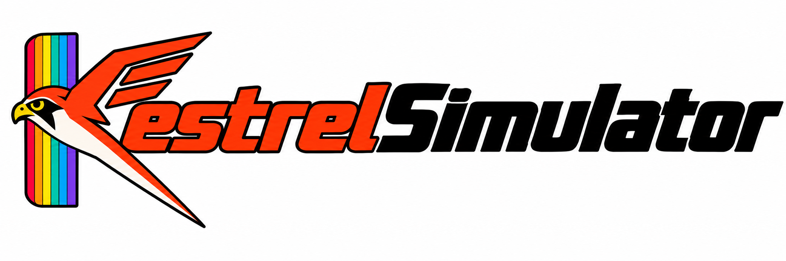

Kestrel Simulator lets you build and simulate TTL logic circuits. It comes with a library of 74-series chips, plus ROM and RAM parts you can load images into. You can also import a KiCad schematic and simulate the board.

## Building

On Windows, from PowerShell:

```powershell
.\kestrel.ps1 --Setup   # once: installs MSYS2 with MinGW, CMake and Ninja
.\kestrel.ps1 --Build
.\kestrel.ps1 --Run
```
